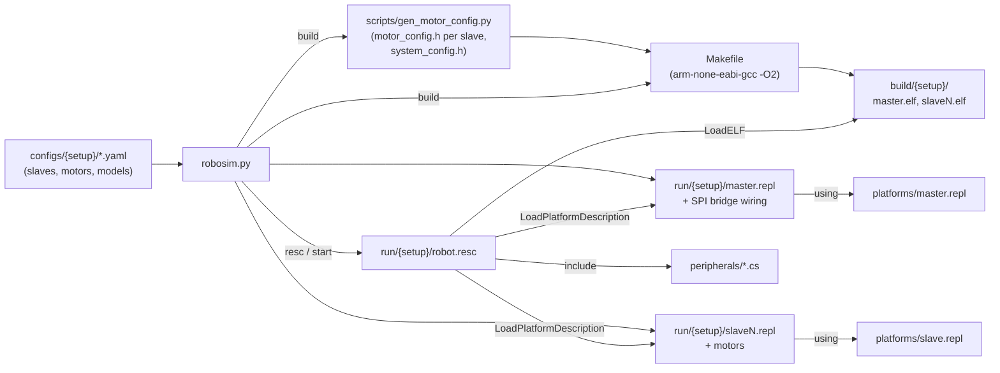
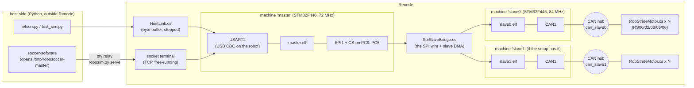
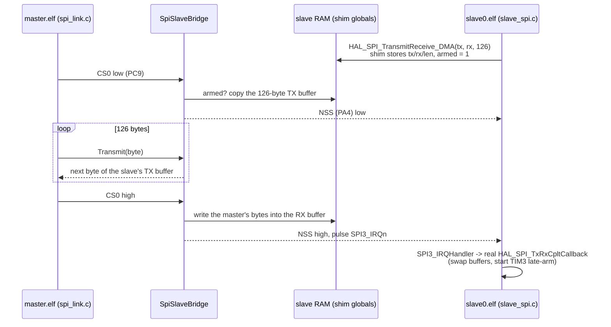

# Firmware emulator (Renode)

Runs the production master and slave firmware in [Renode](https://renode.io), with emulated
RobStride motors on each slave's CAN bus. You get the robot's real host link without any
hardware: drive it by hand (`jetson.py`), check it automatically (`test_sim.py`), or point a host
program such as soccer-software's transport at it (`robosim.py serve`).

> **Behaviour, never timing.** Renode time is virtual: the emulated robot runs 3–5x slower than
> wall time and nothing in it is cycle-accurate. Use it for protocol, state machines, counters and
> fault reactions. Do not use it for latency, deadlines or jitter. ADR-007 says the same of any
> simulation.

## Quick start (Linux / WSL)

```bash
sudo apt install gcc-arm-none-eabi libnewlib-arm-none-eabi make python3-yaml
# Renode 1.17+, portable build in ~/tools/renode (or set RENODE=/path/to/renode)

cd sim/renode
python3 robosim.py build --setup 1s_1m   # master.elf + one slaveN.elf per slave, ~30 s
python3 jetson.py --setup 1s_1m          # be the Jetson by hand: boot, cmd ENABLE, step, motor ...
python3 test_sim.py --setup 1s_1m        # scenario tests (every built setup if --setup is omitted)
python3 robosim.py serve --setup 1s_1m   # run free; host link on /tmp/robosoccer-master
```

`--setup` picks `configs/<setup>/`, the same switch the firmware build uses. Without it,
`$SOCCER_SETUP` applies, then `configs/active`. The setup decides how many slaves there are and
which motors sit on each bus, so the emulated robot always matches the firmware it runs.

## Renode in two minutes

Renode emulates whole boards. It runs an unmodified ELF on an emulated CPU, with models of the
chip's peripherals. Four kinds of file are involved:

| File | What it is | Here |
|---|---|---|
| `.repl` | **Platform description**: which peripherals sit at which addresses and how they connect. One per board. | `platforms/master.repl`, `platforms/slave.repl` (stock STM32F4 with the clocks fixed); generated `run/<setup>/*.repl` add the motors and the SPI wiring |
| `.resc` | **Script**: monitor commands that build the emulation. It creates machines, loads a `.repl` and an `.elf` into each, and connects the buses. | generated `run/<setup>/robot.resc` |
| `.elf` | **Firmware**, exactly what you would flash | `build/<setup>/master.elf`, `slave0.elf`, ... |
| `.cs` | **Custom peripheral** models in C#, compiled by Renode when a script `include`s them | `peripherals/*.cs` |

The **monitor** is Renode's command line. A `.resc` is just a list of monitor commands.
`robosim.py` drives the monitor over a socket. **Virtual time** advances only on `start` (free
run) or `emulation RunFor "00:00:00.005"` (exactly 5 ms, then pause). That is why `jetson.py`
can freeze the robot between your commands.

You can do everything `robosim.py` does by hand:

```bash
python3 robosim.py resc --setup 1s_1m           # writes run/1s_1m/robot.resc (+ .repl files)
~/tools/renode/renode run/1s_1m/robot.resc      # opens the monitor with the robot loaded
(master) start                                  # or: emulation RunFor "00:00:04"
(master) mach set "slave0"
(slave0) sysbus.motor1 Status                   # an emulated motor's ground truth
```

How the files fit together:



## The emulated robot

One Renode **machine** per MCU, wired the way the real boards are:



### What is real and what is substituted

Everything under `firmware/*/Core` and the ST HAL is compiled unmodified, with the CubeIDE Debug
flags (`-O2 -g3 -fno-strict-aliasing`). That includes `usb_link.c` (rings, frame scanner),
`master_app.c`, `spi_link.c`, `slave_spi.c` (ping-pong buffers, TIM3 late-arm, resync), the
motor runtime, the state machines and the protocol. Renode cannot model four things, so they are
substituted:

| Seam | Why | Substitute | Not exercised |
|---|---|---|---|
| Master USB CDC | Renode has no USB device model | `shim/master_host_uart.c` replaces the ST USB stack and `usbd_cdc_if.c`, carrying the same bytes on USART2, unpaced (a frame lands at once) | USB enumeration, 64-byte packets, ZLPs, endpoint timing |
| Slave SPI DMA | Renode's STM32 SPI is master-only and no peripheral DMA is wired | `shim/slave_spi_dma.c` replaces only `HAL_SPI_TransmitReceive_DMA` / `HAL_SPI_Abort_IT`; `peripherals/SpiSlaveBridge.cs` plays the wire | Byte-level SPI timing, overrun/underrun |
| Slave DWT cycle counter | The stock platform has none | `peripherals/CortexMDwt.cs` (CYCCNT from virtual time) | – |
| Motors | They are not MCUs | `peripherals/RobStrideMotor.cs`, at protocol level | Electrical, thermal and gearbox behaviour |

### One SPI exchange through the bridge

The slave's SPI is DMA-driven. It *arms* a transfer (TX and RX buffers) and the master's clock
moves the bytes. The shim records the armed buffers in plain globals, and the bridge reads and
writes them in slave RAM:



The bridge keeps three real-hardware properties. The reply is whatever the slave armed *before*
the exchange started. A short exchange leaves the slave's DMA part-way, and the next one carries
on from there, which is the case the firmware's resync handles. An exchange to an unarmed slave
returns zeros. All slave-side effects are posted into the slave machine at the master's
timestamp.

## The motor model (`peripherals/RobStrideMotor.cs`)

The model covers the five models the robot uses. Ranges come from each vendor manual (§4.1.2 /
§4.4); peak torque and inertia from the RS spec sheet
([RobStride/Product_Information](https://github.com/RobStride/Product_Information)). The
protocol is identical across them.

| Model | velocity | torque | Kp | Kd | peak torque | output inertia |
|---|---|---|---|---|---|---|
| RS00 | ±33 rad/s | ±14 N·m | 0–500 | 0–5 | 14 N·m | 0.001 kg·m² |
| RS02 | ±44 | ±17 | 0–500 | 0–5 | 17 | 0.0042 |
| RS03 | ±20 | ±60 | 0–5000 | 0–100 | 60 | 0.02 |
| RS05 | ±50 | ±5.5 | 0–500 | 0–5 | 5.5 | 0.0007 |
| RS06 | ±50 | ±36 | 0–5000 | 0–100 | 36 | 0.012 |

- **Frames.** It answers exactly the frames the slave sends: Type 0 (id), 1 (MIT), 3 (enable),
  4 (stop / clear fault), 6 (zero), 17 (read 0x3022 / 0x7005) and 18 (write run mode).
- **Decoding.** It decodes with the *vendor's* ranges, not the firmware's config. A config with
  the wrong ranges for a model therefore misbehaves here, as it would on the real motor.
- **Rotor.** Inertia, with placeholder viscous and Coulomb friction (friction is not
  published), under the MIT law, clamped to peak torque.
- **Fault hooks.** In the `jetson.py` `motor` command or on the monitor:
  - `Present false` unplugs it.
  - `InjectFault 0..5` (undervoltage, driver, overtemperature, encoder, stall, uncalibrated).
  - `RefuseEnable`.
  - `IgnoreDisable`: ADR-007's "failed joint isolation".
  - `LoadTorque`, `SetPosition`, `Status`.

## Fidelity notes (each one measured)

| Problem found | Effect before the fix | Fix |
|---|---|---|
| Stock platform clocks timers at 10 MHz, SysTick at 72 MHz | 5 ms cycle ran ~7x slow; slave `HAL_GetTick()` ran at 72/84 speed | `platforms/*.repl` set 72 / 84 MHz from `SystemClock_Config()` |
| UART model paces received bytes at a baud derived from BRR assuming an 8 MHz clock (500 kbaud here) | a 270-byte command took 5.4 ms, more than a 5 ms host period, so commands queued and the host-death watchdog never tripped on `1s_5m` | host-link USART2 unpaced (`frequency: 0`): a frame lands at once, as a USB packet does |
| Renode 1.17's paced UART receiver fills an unsynchronised queue from a clock entry that may run on the time-source thread while the CPU thread reads `USART_DR` | in ~1 of 6 ten-second runs at a 200 Hz host rate, the master read `0x00` for every host byte from some point on (seen in the RX ring), so every frame failed CRC | same fix: unpaced, the queue is filled only from time-domain events |
| CAN hub delivers instantly; Renode's bxCAN RX FIFO keeps 3 | with 5 motors, 2 of 5 simultaneous replies were lost every cycle and those motors aged out to ABSENT | motor replies serialised ~135 µs apart, like a real bus |
| Built-in `Miscellaneous.DWT` | slave ran ~6x slower (6.3 s vs 1.1 s wall per 250 ms) | custom `CortexMDwt.cs` |
| Sim build used `-O0` | not the shipped code generation (strict-aliasing and volatile bugs hide at `-O0`) | `-O2 -fno-strict-aliasing`, as CubeIDE Debug |
| Console sent `cycle_id = 0` | every host command was counted `late` | echo the newest telemetry `cycle_id`, as the real host does |
| Parallel runs of one setup rewrote the same `run/<setup>/robot.resc`, and started Renode at the same moment | a Renode instance read a half-written script; separately, 2 of 12 simultaneous starts came up without `hostlink` | generated files are written to a temp file and renamed (`serve` uses its own `robot-serve.resc`); Renode starts are serialised with a file lock, and startup checks that `hostlink` exists (6 of 6 simultaneous starts then succeeded) |

Speed: ~1.6x slower than wall time while booting, ~4.5x once the SPI link runs (1 slave). A larger
Renode time quantum buys at most ~25%, and at 2 ms it breaks the SPI timing (unarmed exchanges),
so the default is kept.

## Testing soccer-software against it

`robosim.py serve` runs the robot freely and creates `/tmp/robosoccer-master`, a pseudo-terminal
relayed to the master's host link. soccer-software opens it like the real `/dev/ttyACM*`: same
bytes, same frames, `TIOCEXCL` and termios work. While it runs you can type monitor commands
(e.g. `mach set "slave0"; sysbus.motor1 InjectFault 2`) to inject faults.

```bash
python3 robosim.py serve --setup 1s_1m                                  # terminal 1
~/soccer-software/build/humanoid_transport_stm32/stm32_link_probe /tmp/robosoccer-master 4000   # terminal 2
```

Because the robot runs 3–5x slower than wall time, a host program with wall-clock deadlines
sees telemetry at ~40–60 Hz instead of 200 Hz. The transport's exchange waits for the next
telemetry cycle, so it paces itself to the robot. Give it generous timeouts and judge behaviour
(handshake, discovery, arming, faults, schema check), never rates.

Where this fits among the test layers (ADR-007):

| Layer | Runs | Proves | Cannot prove |
|---|---|---|---|
| Golden frames + `FIRMWARE_PIN` / schema hash | every commit, both repos | wire layout matches | behaviour |
| soccer-software `FakeMaster` (pty, manual clock) | every commit | host transport logic against a *model* of the firmware | the firmware itself |
| **this emulator** | firmware PRs, firmware-pin bumps, nightly | the *real* firmware's behaviour, end to end, with fault injection | timing, USB, electrical faults |
| bench HIL (H1–H3) | before release | timing, USB CDC, real drives | — |

## Files

| Path | Role |
|---|---|
| `robosim.py` | build, generate the `.resc`/`.repl`, start Renode, drive the monitor, `serve` |
| `jetson.py` | `Host` (the protocol side of a Jetson) + the hand-driven console |
| `test_sim.py` | scenario tests on every built setup |
| `Makefile` | compiles one ELF; called by `robosim.py build` |
| `platforms/*.repl` | stock STM32F4 + this firmware's clocks (+ DWT on the slave) |
| `peripherals/*.cs` | motor, SPI bridge, host-link buffer, DWT |
| `shim/*.c` | the two firmware seams (USB → USART2, slave SPI DMA arming) |
| `build/`, `run/` | generated (gitignored) |

## Gotchas

- **Build generates and restores headers.** `robosim.py build` regenerates
  `motor_config.h` / `system_config.h` / `motor_config_gen.py` once per slave, then restores the
  versions you had, so a sim build never changes what CubeIDE picks up.
- **Load errors show only on the monitor.** If the startup script stops (e.g. a C# compile
  error), the error goes to the monitor, not to `run/<setup>/renode.log`. Run
  `renode run/<setup>/robot.resc` to see it.
- **Socket terminals must be raw.** Renode's socket terminal is Telnet by default and doubles
  every `0xFF` byte. `serve` creates it raw (the trailing `false`).
- **Run git from Windows, not WSL,** in a Windows checkout: WSL git reports every file as
  modified (file modes).
- **`MSYS_NO_PATHCONV=1` in Git Bash.** Set it before `wsl ... /mnt/c/...`, or the path gets
  rewritten.
